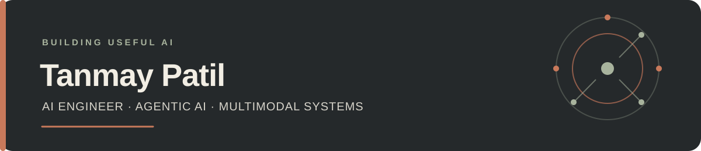

  

  <strong>AI Engineer</strong> &nbsp;·&nbsp; Generative AI &nbsp;·&nbsp; Agentic Systems &nbsp;·&nbsp; Multimodal Products

  I turn models into useful products: connected workflows, grounded answers, and thoughtful interfaces.

  <a href="./Tanmay_Patil_AI_Dev.pdf"><strong>↗ Resume</strong></a>
  &nbsp; / &nbsp;
  <a href="https://www.linkedin.com/in/tanmay-patil-805049250/">LinkedIn</a>
  &nbsp; / &nbsp;
  <a href="mailto:patiltanmay019@gmail.com">Email</a>

 

## Selected work

<table>
  <tr>
    <td width="33%" valign="top">
      01 &nbsp;·&nbsp; GENERATIVE AI 
      <h3><a href="https://github.com/TANMAY4806w/ai-resume-architect">AI Resume Architect ↗</a></h3>
      Tailors a resume to a job description with Gemini, then generates polished PDF and DOCX output.  
      PYTHON &nbsp; / &nbsp; GEMINI &nbsp; / &nbsp; STREAMLIT
    </td>
    <td width="33%" valign="top">
      02 &nbsp;·&nbsp; COMPUTER VISION 
      <h3><a href="https://github.com/TANMAY4806w/treesense-imaging">TreeSense Imaging ↗</a></h3>
      Turns aerial imagery into tree counts, vegetation insights, and navigable forest paths.  
      PYTHON &nbsp; / &nbsp; YOLOv8 &nbsp; / &nbsp; STREAMLIT
    </td>
    <td width="33%" valign="top">
      03 &nbsp;·&nbsp; APPLIED ML 
      <h3><a href="https://github.com/TANMAY4806w/FAKE_NEWS_DET_REACT">Hybrid Fake News Detector ↗</a></h3>
      Combines a machine-learning classifier with web verification in a full-stack app.  
      PYTHON &nbsp; / &nbsp; FLASK &nbsp; / &nbsp; REACT
    </td>
  </tr>
</table>

 

## What I’m building

**AI Trainee · American Hairline** &nbsp; `Mar 2026 — Present`

Designing internal AI products across multimodal image generation, agentic knowledge capture, meeting intelligence, and conversational order automation. My work connects LLMs and speech or image models to the APIs and workflows people use every day.

**Previously · AI Developer Intern, Arkham Archives** &nbsp; `Jun 2025 — Sep 2025`

Built LLM-powered support chatbots and refined multi-turn prompts for more relevant, consistent responses.

## Toolkit

| AREA | TOOLS |
| :--- | :--- |
| **AI & orchestration** | LLMs, RAG, LangGraph, Gemini, OpenRouter, Hugging Face, MCP |
| **Product & APIs** | Python, FastAPI, Flask, React, Next.js, Streamlit, REST |
| **Data & automation** | PostgreSQL, Supabase, Firebase, n8n, Google Apps Script |
| **ML & deployment** | Scikit-learn, TensorFlow, YOLOv8, XGBoost, Docker, AWS, Vercel |

## A little more

**B.Tech · Artificial Intelligence & Machine Learning** 
ALDEL Institute’s St. John’s College of Engineering and Management · `2022–2026` 
Based in Maharashtra, India

---

Curious about applied AI, reliable systems, and the details that make a product feel finished.

