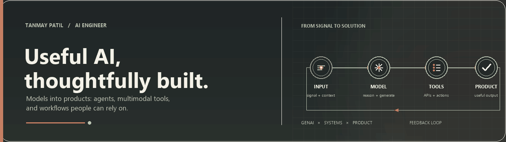

  

  <strong>AI Engineer</strong> &nbsp;·&nbsp; Generative AI &nbsp;·&nbsp; Agentic Systems &nbsp;·&nbsp; Multimodal Products

  I turn models into useful products: connected workflows, grounded answers, and thoughtful interfaces.

  
  &nbsp;&nbsp;
  
  &nbsp;&nbsp;
  

## Selected work

THREE WAYS I BUILD AI INTO SOMETHING USEFUL

<table>
  <tr>
    <td width="33%" valign="top">
       
      01 &nbsp;·&nbsp; GENERATIVE AI
      <h3>AI Resume Architect</h3>
      Turns a job description and your experience into a tailored resume, with polished PDF and DOCX exports.
        PYTHON &nbsp;·&nbsp; GEMINI &nbsp;·&nbsp; STREAMLIT  
      
    </td>
    <td width="33%" valign="top">
       
      02 &nbsp;·&nbsp; COMPUTER VISION
      <h3>TreeSense Imaging</h3>
      Reads aerial imagery for tree counts and vegetation insights, then helps map paths through forest areas.
        PYTHON &nbsp;·&nbsp; YOLOv8 &nbsp;·&nbsp; STREAMLIT  
      
    </td>
    <td width="33%" valign="top">
       
      03 &nbsp;·&nbsp; APPLIED ML
      <h3>Hybrid Fake News Detector</h3>
      Pairs a machine-learning classifier with web verification in a full-stack fact-checking experience.
        PYTHON &nbsp;·&nbsp; FLASK &nbsp;·&nbsp; REACT  
      
    </td>
  </tr>
</table>

## Experience

| ROLE | FOCUS |
| :--- | :--- |
| **AI Trainee · American Hairline** Mar 2026 — Present | Multimodal image generation, agentic knowledge capture, meeting intelligence, and conversational order automation. |
| **AI Developer Intern · Arkham Archives** Jun 2025 — Sep 2025 | LLM-powered support chatbots and multi-turn prompt improvements for more relevant, consistent responses. | LLM-powered support chatbots and multi-turn prompt improvements for more relevant, consistent responses. |

## Toolkit

| AREA | TOOLKIT |
| :--- | :--- |
| **AI systems** | LLMs · RAG · LangGraph · Gemini · OpenRouter · Hugging Face · MCP |
| **Apps & APIs** | Python · FastAPI · Flask · React · Next.js · Streamlit · REST |
| **Data & automation** | PostgreSQL · Supabase · Firebase · n8n · Google Apps Script |
| **ML & delivery** | Scikit-learn · TensorFlow · YOLOv8 · XGBoost · Docker · AWS · Vercel |

## Beyond the screen

**B.Tech in Artificial Intelligence & Machine Learning** 
ALDEL Institute’s St. John’s College of Engineering and Management · `2022–2026` 
Based in Maharashtra, India

---

Interested in building useful AI products? <a href="mailto:patiltanmay019@gmail.com">Let’s connect ↗</a>

